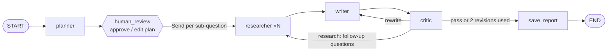

# Tech Comparison Research Agent (LangGraph)

A multi-step research agent built with **LangGraph**. Give it a tech comparison question, approve its research plan, and it searches the web in parallel, writes a cited Markdown report, reviews its own draft and revises it. It runs entirely on **free tiers** (Groq + Tavily, with DuckDuckGo as a no-key fallback).

 <!-- TODO: record a GIF of the Streamlit app -->

## How it works



## LangGraph features demonstrated

| Feature | Where |
|---|---|
| Typed `StateGraph` state with a reducer | `findings` merges results from parallel researchers |
| Structured output | Planner returns a `Plan`, critic returns a `Critique` (Pydantic) |
| Parallel fan-out with `Send` | One researcher per sub-question, capped by `max_concurrency` |
| Human-in-the-loop with `interrupt()` | Run pauses after planning; resume with `Command(resume=...)` |
| Conditional edges and cycles | Critic routes to writer, researchers or save, with a revision cap |
| Persistence | `SqliteSaver`: resume a paused run by thread id, even after a restart |
| Streaming | CLI and Streamlit show each node as it finishes |
| LangGraph Studio | `langgraph.json` + `uv run langgraph dev` |

## Setup

Requires Python 3.13 and [uv](https://docs.astral.sh/uv/).

```zsh
uv sync
cp .env.example .env   # add free keys from console.groq.com and tavily.com
```

No Tavily key? Leave it blank and DuckDuckGo is used instead.

## Run

```zsh
# CLI
uv run research-agent "LangGraph vs CrewAI for multi-agent apps"
uv run research-agent --thread <id>        # resume a paused run

# Streamlit UI
uv run streamlit run app.py

# LangGraph Studio
uv run langgraph dev

# Tests (fake LLM and search, no keys needed)
uv run pytest
uv run pytest -m live                      # real APIs, uses free quota
```

Reports are saved to `reports/<question>.md`. See [reports/sample-report.md](reports/sample-report.md).

## Configuration

Set in `.env` (see `.env.example`): `LLM_PROVIDER` (`groq`, `gemini` or `ollama`), `LLM_MODEL`, `CRITIC_MODEL`, `MAX_REVISIONS`, `MAX_RESULTS`, `MAX_SOURCE_CHARS`, `MAX_CONCURRENCY`.

## Project layout

```
src/research_agent/
  config.py   settings from .env
  llm.py      Groq / Gemini / Ollama chat models
  search.py   SearchProvider: Tavily → DuckDuckGo fallback
  state.py    graph state, Plan and Critique schemas
  graph.py    nodes, routing and build_graph()
  cli.py      command-line front end
  studio.py   entry point for LangGraph Studio
app.py        Streamlit front end
tests/        graph tests with fake providers
```
