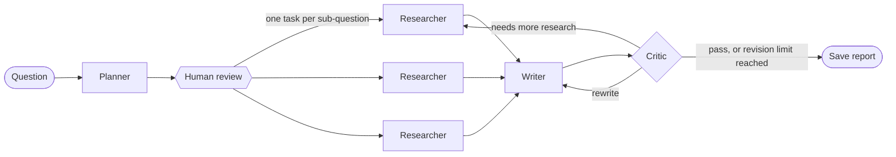

# Why Your LLM Needs a Workplace: LangChain, LangGraph and LangSmith

Think of a large language model as a very capable intern. It reads quickly, writes fluently and never gets tired. It also misreads instructions, skips steps and hands in work in whatever format it feels like that day. Hiring a smarter intern doesn't fix this. A better workplace does: standard forms, a clear process and a record of what was done.

The smallest version of that idea is one line of code:

```python
plan = llm.with_structured_output(Plan).invoke(PLANNER_PROMPT.format(question=question))
```

Instead of free text that you have to parse and hope is correct, the model returns a validated `Plan` object with a list of sub-questions. One line removes a whole category of bugs.

That line comes from a research agent I built with LangChain, LangGraph and LangSmith. Each tool solves a different problem. This article explains which problem each one solves, so you can decide whether you need it.

## The agent

The agent takes a question such as "FastAPI vs Flask performance" and returns a cited Markdown report.



A planner breaks the question into sub-questions. A person approves or edits the plan. Researchers search the web in parallel. A writer drafts the report, and a critic scores it. If the draft fails, it goes back for a rewrite or more research, up to a fixed number of revisions.

## LangChain: one interface for every model

**Without it**, every provider has its own SDK, message format and way of returning structured data. Changing models means rewriting the code that calls them, and getting JSON out of a model means writing parsing and retry logic yourself.

**With it**, every chat model has the same interface: `invoke`, `stream` and `with_structured_output`. My planner and critic both return Pydantic objects (`Plan` and `Critique`), so the rest of the code works with typed fields instead of strings. Because the critic receives its model as a separate argument, it can run on a different model from the writer without any other code changes.

LangChain also provides standard interfaces for retrieval, embeddings and vector stores. Most of those integrations are installed as separate packages, but they share the same interfaces.

## LangGraph: the process, written down

**Without it**, a multi-step agent becomes a `while` loop that passes a growing set of variables from step to step. Then you need parallel searches, a revision limit, a pause for human approval and the ability to resume after a crash, and the loop becomes the hardest part of the codebase to change.

**With it**, the process is a graph:

- **Shared, typed state.** Each node reads the state and returns only the fields it changes.
- **Conditional edges.** The critic's verdict decides the next step: rewrite, research more or save. A `max_revisions` setting guarantees the loop ends.
- **Parallel work.** `Send` starts one researcher per sub-question, and their findings are merged back into the state.
- **Human approval.** `interrupt()` pauses the run after planning. The caller can accept or edit the plan and resume with `Command(resume=...)`.
- **Checkpointing.** Each step is saved, which is what makes pausing, resuming and inspecting past steps possible.

The graph code describes the process instead of hiding it inside control flow.

## LangSmith: seeing what happened

**Without it**, a bad report is a mystery. The cause could be a vague plan, weak search results, a writer that ignored its sources or a critic that approved too quickly. You add print statements, run the agent again and pay for the tokens again.

**With it**, every run is recorded as a trace. Each node's inputs, outputs, latency and token usage are listed in order. When a report came back without citations, the trace showed the exact critic call, the score it gave and the draft it was judging, so I knew which prompt to fix instead of guessing.

LangSmith also supports evaluations: you run the agent against a dataset and score the results. That's how you check that a prompt change actually improved the output. For me, the traces alone were enough to justify setting it up.

## Do you need all three?

No. They're independent:

- A single prompt with no loop doesn't need LangGraph.
- LangGraph works without LangChain models.
- LangSmith can trace any Python code with the `@traceable` decorator.

They're useful together because each one covers a different weakness: inconsistent output, fragile process, and work you can't see. Once an LLM application has more than one step, you usually run into all three.

## Try it

The full agent, including the graph, prompts and tests that run without API keys, is on GitHub: **[REPO_URL]**

Clone it, run it on a question you care about and open the trace in LangSmith.
