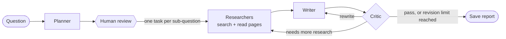

# Why Your LLM Needs a Workplace: LangChain, LangGraph and LangSmith

Think of a large language model as a very capable intern. It reads quickly, writes fluently and never gets tired. It also misreads instructions, skips steps and hands in work in whatever format it feels like that day. Hiring a smarter intern doesn't fix this. A better workplace does: standard forms, a clear process and a record of what was done.

The smallest version of that idea is one line of code:

```python
plan = llm.with_structured_output(Plan).invoke(PLANNER_PROMPT.invoke({"question": question}))
```

Instead of free text that you have to parse and hope is correct, the model returns a validated `Plan` object with a list of sub-questions. One line removes a whole category of bugs.

That line comes from a research agent I built with LangChain, LangGraph and LangSmith. It runs entirely on a laptop, using a local `qwen3:8b` model through Ollama. Each tool solves a different problem. This article explains which problem each one solves, so you can decide whether you need it.

## The agent

The agent takes a question such as "FastAPI vs Flask for REST APIs" and returns a cited Markdown report.



A planner breaks the question into sub-questions, and a person approves or edits the plan. Researchers work on the sub-questions in parallel: each one chooses its own searches, reads the pages it finds and keeps the most relevant passages. A writer drafts the report, and a critic scores it. If the draft fails, it goes back for a rewrite or more research, up to a fixed number of revisions.

## LangChain: one interface for models, tools and documents

**Without it**, every provider has its own SDK and message format, every tool needs custom glue code, and getting structured data out of a model means writing your own parsing and retry logic.

**With it**, these share a common interface:

- **Models.** `init_chat_model` creates a Groq, Gemini or local Ollama model from a setting, and the rest of the code doesn't change. A hosted model can fall back to another provider when it hits a rate limit.
- **Structured output.** The planner and critic return Pydantic objects (`Plan` and `Critique`), so the rest of the code works with typed fields instead of strings.
- **Tools.** Web search is wrapped as a `@tool`. Instead of searching each sub-question word for word, the model writes its own queries: given "How fast is FastAPI compared to Flask?", it searched for "FastAPI vs Flask performance benchmark".
- **Retrieval.** Search snippets are short. The researcher downloads the full pages, splits them into chunks, embeds them with a local `nomic-embed-text` model and gives the writer only the most relevant passages.

## LangGraph: the process, written down

**Without it**, a multi-step agent becomes a `while` loop that passes a growing set of variables from step to step. Then you need parallel research, a revision limit, a pause for human approval and the ability to resume after a crash, and the loop becomes the hardest part of the codebase to change.

**With it**, the process is a graph:

- **Shared, typed state.** Each node reads the state and returns only the fields it changes. Findings from parallel researchers are merged automatically.
- **Conditional edges.** The critic's verdict decides the next step: rewrite, research more or save. A `max_revisions` setting guarantees the loop ends.
- **Parallel work.** `Send` starts one researcher per sub-question.
- **Human approval.** `interrupt()` pauses the run after planning. The caller can accept or edit the plan and resume with `Command(resume=...)`.
- **Checkpointing.** Each step is saved to SQLite, so a paused run can be resumed later, even after a restart.

The graph code describes the process instead of hiding it inside control flow.

## LangSmith: seeing what happened

**Without it**, a bad report is a mystery. The cause could be a vague plan, poor search queries, pages that failed to load, a writer that ignored its sources or a critic that approved too quickly. You add print statements, run the agent again and wait another few minutes.

**With it**, every run is recorded as a trace once you set an environment variable. Each step's inputs, outputs, latency and token usage are listed in order: every search query the model chose, every passage it retrieved and every score the critic gave. When a report is weak, you open the trace and find the step that went wrong instead of guessing.

LangSmith also supports evaluations, where you run the agent against a set of questions and score the results to check that a change actually helped. Tracing alone was enough to justify setting it up.

## Do you need all three?

No. They're independent:

- A single prompt with no loop doesn't need LangGraph.
- LangGraph works without LangChain models.
- LangSmith can trace any Python code with the `@traceable` decorator.

They're useful together because each one covers a different weakness: inconsistent output, fragile process, and work you can't see. Once an LLM application has more than one step, you usually run into all three.

## Try it

The full agent is on GitHub, including the graph, prompts and tests that run without API keys or a running model: **[github.com/ChristineWanjau/research-agent](https://github.com/ChristineWanjau/research-agent)**

Clone it, pull two Ollama models and run it on a question you care about. If you turn on LangSmith, open the trace and follow the agent's work step by step.
